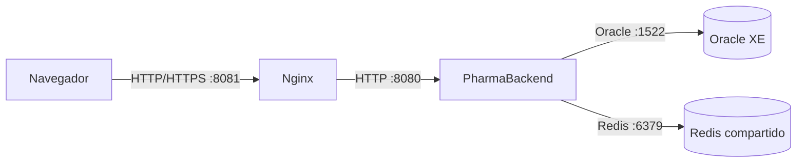

# PharmaBackend

## Despliegue en producción

### Arquitectura y puertos

El navegador llega a Nginx, que sirve el frontend y reenvía `/api/` al backend. El backend se conecta a Oracle y Redis en una red privada. En producción usa HTTPS en el proxy, un único Redis administrado por los tres locales y acceso restringido a la red de datos.

### Variables de entorno

| Variable | Propósito |
|---|---|
| `SPRING_PROFILES_ACTIVE` | Debe ser `prod` para activar la configuración de producción. |
| `SERVER_PORT` | Puerto HTTP del backend; predeterminado 8080. |
| `DB_URL` | Cadena JDBC del servicio Oracle. |
| `DB_USERNAME`, `DB_PASSWORD` | Credenciales de la cuenta de aplicación en Oracle. |
| `JWT_SECRET` | Clave Base64 aleatoria de al menos 256 bits para firmar tokens. |
| `JWT_EXPIRACION_MINUTOS` | Duración del token de acceso; predeterminado 30 minutos. |
| `REDIS_HOST`, `REDIS_PORT`, `REDIS_PASSWORD` | Conexión privada a Redis; puerto predeterminado 6379. |
| `APP_CACHE_TTL` | Vigencia de caché; predeterminada 10 minutos. |

No almacenes valores reales en el repositorio. Usa un gestor de secretos en producción y rota las credenciales que hayan sido expuestas en archivos de configuración locales.

### Construcción y despliegue

1. Provisiona Oracle y Redis, crea una cuenta de base de datos con permisos mínimos y verifica conectividad desde el servidor del backend.
2. Define las variables de entorno en el servicio de ejecución y configura `SPRING_PROFILES_ACTIVE=prod`.
3. Construye el artefacto con `./mvnw -DskipTests package` (Windows: `mvnw.cmd -DskipTests package`) y despliega el JAR generado.
4. Inicia el backend y consulta `/actuator/health`. El detalle de health y las métricas están restringidos a administradores; el estado básico de health es público.
5. Despliega el frontend en Nginx y verifica una consulta de catálogo y el registro de una venta desde cada local.

### Reversión

Conserva el JAR anterior y los artefactos del frontend de cada versión. Si falla la aplicación, vuelve a desplegar el JAR anterior y restaura la versión compatible del frontend. No ejecutes una reversión destructiva del esquema de Oracle sin validar dependencias; restaura una copia de seguridad probada si la versión anterior requiere un esquema previo.

### Buenas prácticas y acciones pendientes

| Práctica | Estado | Acción pendiente |
|---|---|---|
| Configuración de producción externalizada | Cumple parcialmente | Mantener contraseñas y JWT solo en el gestor de secretos. |
| Caché Redis con TTL e invalidación | Cumple | Probar expiración y operaciones del catálogo en el entorno de despliegue. |
| Métricas y health de Actuator | Cumple parcialmente | Configurar alertas y acceso administrativo restringido a la red de operaciones. |
| Trazabilidad mediante `X-Request-Id` y MDC | Cumple | Centralizar los logs y definir retención. |
| Logs sin contraseñas, tokens ni DNI completos | Cumple parcialmente | Revisar periódicamente los logs de producción y retirar datos locales sensibles. |
| Oracle con copias de seguridad | Pendiente de operación | Programar copias y ensayar restauraciones antes de abrir los tres locales. |

### Recomendaciones priorizadas para los tres locales

1. **HTTPS y secretos:** habilita TLS en Nginx o en el proxy de entrada, conserva Oracle y Redis en una red privada y administra claves y contraseñas mediante un gestor de secretos.
2. **Respaldo de datos:** programa copias cifradas de Oracle con retención definida y prueba restauraciones periódicas.
3. **Operación compartida y alertas:** usa un servicio Redis compartido con disponibilidad adecuada para los tres locales y alerta ante `/actuator/health` en estado `DOWN`, errores HTTP y falta de espacio.
